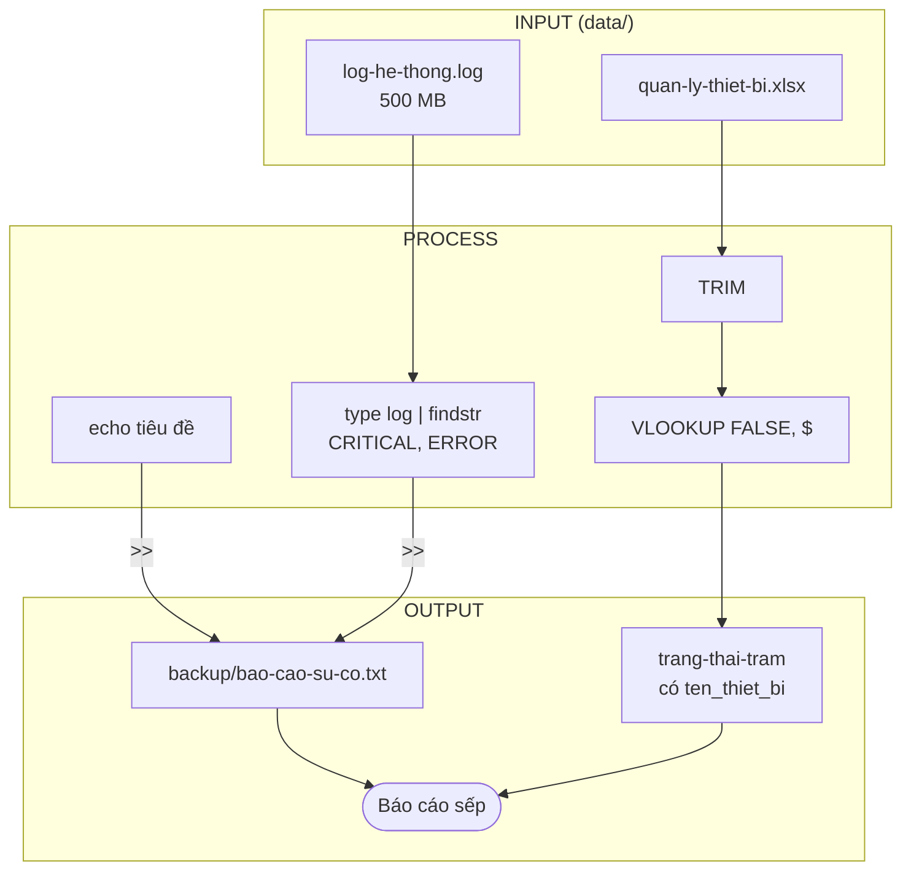
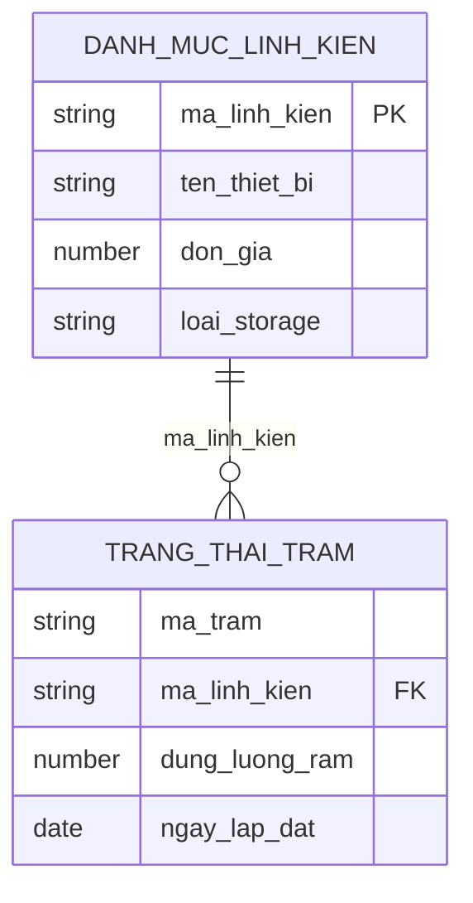

# GreenTech System

Hệ thống quản lý hạ tầng GreenTech: lọc log lỗi tự động và quản lý phần cứng 100 trạm cảm biến IoT.

## 1/ Sơ đồ hệ thống



### Quan hệ dữ liệu



## 2/ Hướng dẫn chạy script

```bat
cd greentech-system\scripts
auto_report.bat
```

Kết quả: `backup\bao-cao-su-co.txt`

## 3/ Checklist kiểm tra thiết bị

- [ ] Trạm có điện và có kết nối mạng
- [ ] Mã linh kiện của trạm có trong `danh-muc-linh-kien`
- [ ] RAM và ổ lưu trữ (SSD/HDD) đúng thông số
- [ ] Đã ghi ngày lắp đặt trong `trang-thai-tram`
- [ ] Đã chạy `auto_report.bat` và xem `bao-cao-su-co.txt`

## 4/ Bảng thông số phần cứng

| ma_linh_kien | ten_thiet_bi | loai_storage | don_gia (VND) |
|---|---|---|---:|
| LK001 | Raspberry Pi 4B 4GB | SSD | 1.350.000 |
| LK002 | Raspberry Pi 4B 8GB | SSD | 1.950.000 |
| LK003 | Jetson Nano 4GB | SSD | 2.500.000 |
| LK004 | Orange Pi 5 8GB | SSD | 2.100.000 |
| LK005 | Intel NUC N100 8GB | SSD | 4.200.000 |
| LK006 | Gateway ARM 2GB | HDD | 1.100.000 |
| LK007 | Mini PC Celeron J4125 4GB | HDD | 3.300.000 |
| LK008 | Rock Pi 4 4GB | SSD | 1.600.000 |

> Đơn giá là số liệu đề xuất.
